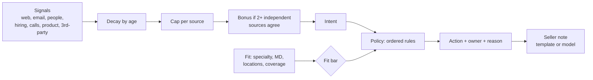

# account-signals

[](https://github.com/vrutikadani/account-signals/actions/workflows/ci.yml)

Account signals in, a short list of seller actions out: each one with an owner, a reason, and a note the seller can read in five seconds.

This is a reference design for a problem I work on in production: turning enrichment, intent, web and conversation signals (Clay, Common Room, Gong, CRM activity) into prioritized work inside a HubSpot and Salesforce stack. It is rebuilt with synthetic accounts. No company data, weights or source code are included.

## The problem

Signal tools are easy to buy and easy to drown in. The common failure isn't missing signals; it's three others:

- **Everything looks hot.** One third-party intent feed fires for half the database, so "most signals" means "noisiest vendor."
- **Busy isn't buying.** Students, competitors and researchers visit pricing pages too.
- **Scores don't change behavior.** A list of 300 "hot" accounts for a team that can work 40 a week gets ignored after the first Monday.

A signal has no value until it changes what someone does. So this system is judged by one question: **if sellers can only work K accounts this week, does this list get them more meetings than the obvious alternative?**

## How it decides



| Step | Deterministic? | Why |
|---|---|---|
| Decay, caps, diversity bonus, fit gate | Yes, `score.py` | Sellers have to be able to argue with the score, so every point traces to a signal and a date |
| Which action, which person | Yes, `policy.py` | Ownership, cooldowns and capacity are business rules, not predictions |
| The two-sentence note | Model allowed, `note.py` | The only step where fluent language helps. It gets the decided action and the reasons, and nothing it writes flows back into the score |

The policy is an ordered list, first match wins: below threshold → nothing; touched in the last 14 days → nothing; open opportunity → context for the AE, not a new sequence; customer → expansion play; intent without fit → marketing nurture; owned → owner task; unowned → SDR round-robin. **Capacity is part of the policy:** once a rep has five new tasks today, the next account carries to tomorrow instead of piling onto a list nobody will finish.

## Does it work?

`backtest.py` ranks the same accounts four ways, takes the top 40 (a week of seller capacity), and counts meetings booked in the next 30 days. Averaged over 30 synthetic worlds of 400 accounts:

```
method         meetings (mean)  worst  best
random                     8.6      2    17
signal count              12.9      6    21
no guards                 15.0      8    22
this model                23.1     19    30
this model ranked strictly first in 28/30 worlds
```

**Read this carefully.** The synthetic world was built with the failure modes above (a noisy intent feed, busy poor-fit accounts, stale activity), so the result shows the guards do what they were designed to do. It does not show these weights are right for any real business. On real data the same script runs as a replay: last quarter's signals in, last quarter's meetings as the outcome. That replay, not this one, is what weights should be tuned on.

## Failure modes

| What goes wrong | What happens |
|---|---|
| A vendor floods one signal type | Capped per source; can't outscore one real reply |
| A new signal type appears in the feed | Ignored until someone adds it to config with a weight and half-life |
| A rep gets 30 tasks in one day | Can't happen; capacity carries the rest to tomorrow |
| Account was just worked by a seller | Cooldown suppresses it; no double touch |
| The note model is down, rambling, or names the wrong account | Template note is used instead |
| A good-fit account with no recent signals | Gets nothing. This system finds timing, not fit; fit-only prospecting belongs elsewhere |

## Tradeoffs

- **Hand-set weights, not a trained model.** With a few hundred meetings a quarter, a trained model mostly learns noise, and sellers won't act on a score nobody can explain. Weights start from seller input and won-deal review, then get checked against the replay.
- **Fit gates intent, it doesn't add to it.** Adding them lets a very busy bad-fit account outrank a quiet good one. Gating keeps seller time for accounts that can actually buy.
- **Half-lives differ by signal.** A pricing visit goes cold in a week; a champion changing jobs stays relevant for two months.

## Limitations

- No account matching. Real signals arrive keyed by domain, email or company name, and resolving those to one account is most of the real work.
- Weights and half-lives here are illustrative.
- The backtest is synthetic (see above). There's no live feedback loop from seller dispositions yet. That's what would show which reasons sellers actually trust.

## Run

```bash
pip install -r requirements.txt
python run_daily.py     # one daily run: actions by type, first 8 tasks, why some hot accounts got none
python backtest.py      # the comparison above
python -m pytest -q     # decay, caps, diversity, fit gate, rule order, capacity, note fallbacks
```

Set `ANTHROPIC_API_KEY` to have Claude write the seller notes instead of the template.

More on the reasoning: [docs/decisions.md](docs/decisions.md).
