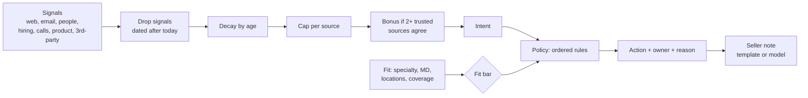

# account-signals

[](https://github.com/vrutikadani/account-signals/actions/workflows/ci.yml)

Account signals in, a short list of seller actions out: each one with an owner, a reason, and a note the seller can read in five seconds.

This is a clean-room reference implementation using synthetic data. It explores one problem: turning enrichment, intent, web and conversation signals into prioritized seller work in a CRM. All accounts, signals and outcomes are generated by `data/generate.py`; the weights are illustrative. No company data, weights or code are included.

For a more complete system in the same family, see [product-signal-router](https://github.com/vrutikadani/product-signal-router).

## The problem

Signal tools are easy to buy and easy to drown in. The common failure isn't missing signals; it's three others:

- **Everything looks hot.** One third-party intent feed fires for half the database, so "most signals" means "noisiest vendor."
- **Busy isn't buying.** Students, competitors and researchers visit pricing pages too.
- **Scores don't change behavior.** A list of 300 "hot" accounts for a team that can work 40 a week gets ignored after the first Monday.

A signal has no value until it changes what someone does. So this system is judged by one question: **if sellers can only work K accounts this week, does this list get them more meetings than the obvious alternative?**

## How it decides



| Step | Deterministic? | Why |
|---|---|---|
| As-of filter, decay, caps, diversity bonus, fit gate | Yes, `score.py` | Sellers have to be able to argue with the score, so every point traces to a signal and a date |
| Which action, which person | Yes, `policy.py` | Ownership, cooldowns and capacity are business rules, not predictions |
| The two-sentence note | Model allowed, `note.py` | The only step where fluent language helps. It gets the decided action and the reasons, and nothing it writes flows back into the score |

Scoring is as-of the run date: a signal dated after `today` is dropped, not scored. The third-party intent feed is listed in `low_trust_sources`, so it still adds intent but doesn't count toward the "2+ sources agree" bonus.

The policy is an ordered list, first match wins: below threshold → nothing; touched in the last 14 days → nothing; open opportunity → context for the AE, not a new sequence; customer → expansion play; intent without fit → marketing nurture; owned → owner task; unowned → SDR round-robin. **Capacity is part of the policy:** every task that lands on a rep counts against a cap of five new tasks a day. Past the cap, the account gets no task and is reported as overflow in the daily output. Overflow is not carried or queued; the next run re-scores from scratch. An open opportunity or customer with no owner goes to a named unassigned queue (`UNASSIGNED-REVIEW`) with the reason.

## Does it work?

`backtest.py` is a forward test on synthetic data. The generator gives each meeting a date (from 20 days before to 60 days after the run date). The backtest ranks 400 accounts four ways using only signals dated on or before the run date, takes the top 40 (a week of seller capacity), and counts how many have a meeting dated in the 30 days after. A test checks that adding future-dated signals changes nothing. Averaged over 30 fixed seeds:

```
method         meetings (mean)  worst  best
random                     2.7      0     7
signal count               4.7      1     9
no guards                  5.3      1    12
this model                 8.3      3    16
this model ranked strictly first in 24/30 worlds
```

About 7% of accounts (4% to 9% by seed) have a meeting in the window, so 40 random picks find about 3.

**What this does and doesn't show.** The results are optimistic by construction. The same hidden propensity drives both the signals and the meetings, and the generator was written alongside the scoring config: it builds in exactly the failure modes the guards target (a noisy intent feed, busy poor-fit accounts, stale activity). So the result shows the guards do what they were built to do on a world built to need them. It does not show these weights are right for any real business. A real test would replay historical signals against historical meetings; this repo has no loader for that.

## Failure modes

| What goes wrong | What happens |
|---|---|
| A vendor floods one signal type | Capped at 40 points per source, and a low-trust source doesn't earn the diversity bonus |
| A new signal type appears in the feed | Ignored until someone adds it to config with a weight and half-life |
| A rep gets 30 tasks in one day | Every task branch checks the rep's cap of five; the rest is reported as overflow, not assigned |
| An open opportunity or customer has no owner | Goes to the `UNASSIGNED-REVIEW` queue with the reason |
| A signal is dated after the run date | Dropped before scoring |
| Account was just worked by a seller | Cooldown suppresses it; no double touch |
| The note model is down, rambling, names the wrong account, or adds a number or claim not in the evidence | Template note is used instead. The check is a cheap guard (full name or ID, numbers, a short list of claim words), not a fact-checker |
| A good-fit account with no recent signals | Gets nothing. This system finds timing, not fit; fit-only prospecting belongs elsewhere |

## Tradeoffs

- **Hand-set weights, not a trained model.** With a few hundred meetings a quarter, a trained model mostly learns noise, and sellers won't act on a score nobody can explain. In a real deployment, weights would start from seller input and won-deal review, then be checked against a historical replay. Here they are illustrative.
- **Fit gates intent, it doesn't add to it.** Adding them lets a very busy bad-fit account outrank a quiet good one. Gating keeps seller time for accounts that can actually buy.
- **Half-lives differ by signal.** A pricing visit goes cold in a week; a champion changing jobs stays relevant for two months.

## Limitations

- No account matching. Real signals arrive keyed by domain, email or company name, and resolving those to one account is most of the real work.
- Weights and half-lives here are illustrative.
- The backtest is synthetic and optimistic (see above). There's no historical replay and no feedback loop from seller dispositions. Those are what would show which reasons sellers actually trust.
- Overflow is reported, not carried over. There is no task queue across days.

## Run

```bash
pip install -r requirements.txt
python run_daily.py             # one daily run: actions by type, first 8 tasks, overflow, why some hot accounts got none
python backtest.py              # the comparison above
python backtest.py --check      # CI gate: exit 1 unless the model beats signal counting
python -m pytest -q             # as-of filter, decay, caps, diversity, fit gate, rule order, capacity, note guard, leakage
```

Model-written notes are off by default. To try them, set `ANTHROPIC_API_KEY` and run `python run_daily.py --model-notes`. Tests never call the network.

More on the reasoning: [docs/decisions.md](docs/decisions.md).
